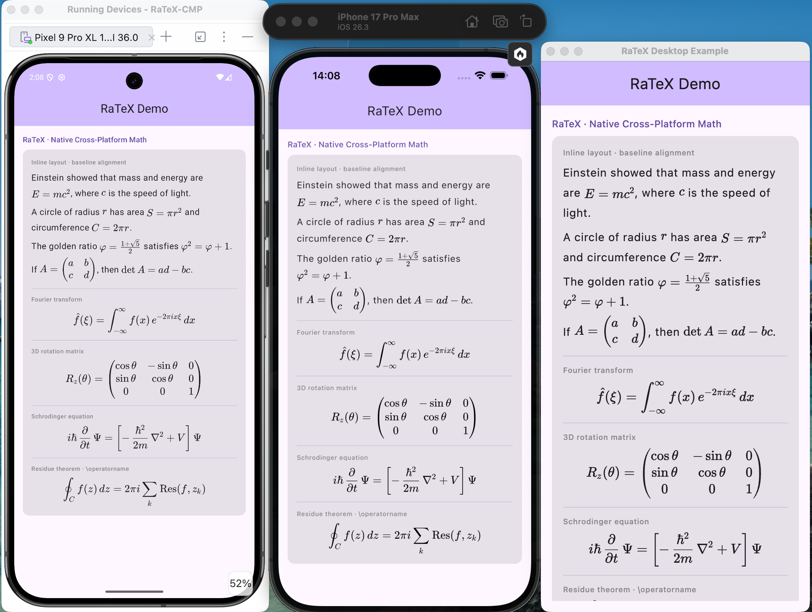
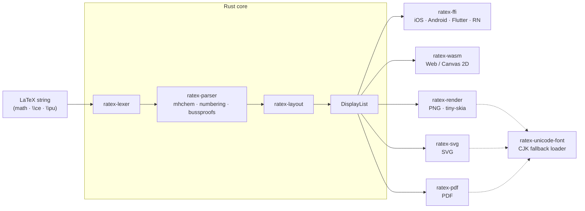

# RaTeX

[简体中文](README.zh-CN.md) | **繁體中文** | [English](README.md)

**純 Rust 實作、相容 KaTeX 的數學公式算繪引擎 — 不需要 JavaScript、不需要 WebView、不需要 DOM。**

一個 Rust 核心、一份顯示清單（display list），各平台原生算繪。

```
\frac{-b \pm \sqrt{b^2-4ac}}{2a}   →   iOS · Android · Flutter · React Native · Web · PNG · SVG · PDF
```

**[→ 線上展示](https://erweixin.github.io/RaTeX/demo/live.html)** — 輸入 LaTeX，並排比較 RaTeX 與 KaTeX 的結果 ·
**[→ 支援度對照表](https://erweixin.github.io/RaTeX/demo/support-table.html)** — 所有測試公式在 RaTeX 與 KaTeX 的對照 ·
**[→ Web 效能評測](https://erweixin.github.io/RaTeX/demo/benchmark.html)** — 在瀏覽器中正面比較效能

---

## 為什麼選擇 RaTeX？

目前主流的跨平台數學公式算繪方案，都要靠瀏覽器或 JavaScript 引擎來處理 LaTeX：背後藏著一個佔用 50–150 MB 記憶體的 WebView、第一個公式出現前有啟動延遲，也無法保證離線可用。KaTeX 在網頁上表現優異，但在其他場景（iOS、Android、Flutter、伺服器端、嵌入式）中，你不是得內嵌 WebView，就是得呼叫無頭（headless）Chrome。

RaTeX 是同一套相容 KaTeX 的數學引擎，編譯成可移植的 Rust 核心，因此*同一個*算繪器可以在所有地方原生執行，並且在每個目標平台上產生位元組完全一致的輸出。

| | KaTeX | MathJax | **RaTeX** |
|---|---|---|---|
| 執行環境 | JS (V8) | JS (V8) | **純 Rust** |
| 可執行的場景 | 僅限 Web* | 僅限 Web* | **iOS · Android · Flutter · RN · Web · 伺服器 · SVG · PDF** |
| 行動裝置 | WebView 包裝 | WebView 包裝 | **原生** |
| 伺服器端算繪 | 無頭 Chrome | mathjax-node | **單一執行檔，不需要 JS 執行環境** |
| 輸出基底 | DOM（`<span>` 樹） | DOM / SVG | **顯示清單 → Canvas / PNG / SVG / PDF** |
| 記憶體 | GC / 堆積 | GC / 堆積 | **可預期，沒有 GC** |
| 離線 | 視情況而定 | 視情況而定 | **可以** |
| 語法涵蓋率 | 100% | ~100% | **與 KaTeX 數學語法對齊** |

<sub>\* 只有內嵌 WebView 或無頭瀏覽器才能用在非 Web 目標上，而多數原生與伺服器環境無法接受這種做法。</sub>

**單就 Web 而言**，KaTeX 背後有十年的 V8 JIT 最佳化，仍然是純 Web 專案的首選。RaTeX 的貢獻不是在 KaTeX 的主場擊敗它，而是成為唯一能在*其他所有*平台上原生執行的 KaTeX 相容引擎，並且在各平台間輸出像素完全一致。

---

## 能算繪什麼

**數學** — **與 KaTeX 的數學語法對齊**：分數、根號、積分、矩陣、各種環境、可伸縮的定界符等等。少數與 DOM／trust 相關的擴充（例如 `\includegraphics`、`\htmlClass` 等）記載於下方「與 KaTeX 的差異（指令與 DOM）」。

**化學** — 透過 `\ce` 與 `\pu` 完整支援 mhchem：

```latex
\ce{H2SO4 + 2NaOH -> Na2SO4 + 2H2O}
\ce{Fe^{2+} + 2e- -> Fe}
\pu{1.5e-3 mol//L}
```

**物理單位** — 以 `\pu` 表示數值加單位的運算式，遵循 IUPAC 慣例。

**置中否定關係** — `\centernot\implies`、`\centernot{\impliedby}` 與 `\centernot{\iff}` 會將否定斜線置中於整個引數上，並保留關係符號的間距（centernot 套件的語意）。

**費曼斜線記號** — `\slashed{p}` 與 `\slashed{\partial}`，支援上下標與字型指令。

**證明樹** — 採用 bussproofs 風格的 `prooftree`，用於推論規則與相繼式演算：

```latex
\begin{prooftree}
\AxiomC{A \fCenter B}
\LeftLabel{cut}
\RightLabel{\alpha}
\UnaryInfC{C \fCenter D}
\end{prooftree}
```

支援的指令包括 `\AxiomC` / `\AXC`、從一元到五元的推論指令（`\UnaryInfC`、`\BinaryInfC` 等，以及 `\UIC`、`\BIC`、`\TIC` 等縮寫）、`\LeftLabel` / `\RightLabel`（`\LL` / `\RL`）、`\solidLine` / `\singleLine`、`\dashedLine`、`\noLine`、對應的 `\always*Line` 預設值、`\rootAtTop` / `\rootAtBottom`、`\alwaysRootAtTop` / `\alwaysRootAtBottom`，以及 `\fCenter`。

bussproofs 中尚未實作的有：`\InsertBetweenHyps`、`\ScoreTree`、`\Cell` 與 `\noCell`。由於 KaTeX 並未實作 `prooftree`，證明樹的黃金基準（golden reference）採用 MathJax 的 bussproofs 擴充。

### 與 KaTeX 的差異（指令與 DOM）

以下是與 KaTeX 在**指令層級**的差距（包含 `trust` 風格的 HTML）。一般的數學與 mhchem 輸入皆與 KaTeX 對齊。部分公式在[支援度對照表](https://erweixin.github.io/RaTeX/demo/support-table.html)或黃金基準的墨跡比對中，分數仍低於 1.0，這是由於版面／度量／點陣化與參考 PNG 之間的差異，與下表所列的「缺少語法」**並不相同**。

| KaTeX 輸入 | 說明 |
|-------------|------|
| `\includegraphics[…]{…}` | **不支援：** 剖析器沒有對應的處理程式（未定義的控制序列）。 |
| `\htmlClass`、`\htmlData`、`\htmlId` | **不等價：** 會展開為巨集，**捨棄**第一個引數的 `class` / `data-*` / `id`，只保留第二個引數的內容（不同於 KaTeX 受信任的 DOM 屬性）。 |
| `\htmlStyle{…}{…}` | **部分支援：** 簡單的行內樣式在 Web／Canvas 路徑上可能有效；行為仍可能與 KaTeX 以 DOM 為基礎的 HTML 擴充不同。 |

---

## 支援的平台

| 平台 | 做法 | 狀態 |
|---|---|---|
| **iOS** | XCFramework + Swift / CoreGraphics | 開箱即用 |
| **Android** | JNI + Kotlin + Canvas · AAR | 開箱即用 |
| **Flutter** | Dart FFI + `CustomPainter` | 開箱即用 |
| **React Native** | 原生模組 + C ABI · iOS/Android 檢視 | 開箱即用 |
| **Compose Multiplatform** | Kotlin Multiplatform + Compose Canvas · Android / iOS / JVM Desktop | 透過 [`RaTeX-CMP`](https://github.com/darriousliu/RaTeX-CMP) |
| **Web** | WASM → Canvas 2D · `<ratex-formula>` Web Component | 開箱即用 |
| **伺服器 / CI** | `ratex-render` → tiny-skia PNG 點陣化器 | 開箱即用 |
| **SVG** | `ratex-svg` → 自包含的向量 SVG | 開箱即用 |
| **PDF** | `ratex-pdf` → 內嵌 KaTeX 字型的向量 PDF | 開箱即用 |

### 螢幕截圖

來自 [`demo/screenshots/`](demo/screenshots/) 中的示範應用程式。

<table>
  <tr>
    <th width="50%">iOS</th>
    <th width="50%">Android</th>
  </tr>
  <tr>
    <td align="center"></td>
    <td align="center"></td>
  </tr>
  <tr>
    <th width="50%">Flutter (iOS)</th>
    <th width="50%">React Native (iOS)</th>
  </tr>
  <tr>
    <td align="center"></td>
    <td align="center"></td>
  </tr>
  <tr>
    <th colspan="2">Compose Multiplatform</th>
  </tr>
  <tr>
    <td colspan="2" align="center"></td>
  </tr>
</table>

---

## 架構



| Crate | 職責 |
|---|---|
| `ratex-types` | 共用型別：`DisplayItem`、`DisplayList`、`Color`、`MathStyle` |
| `ratex-font` | 相容 KaTeX 的字型度量與符號表 |
| `ratex-lexer` | LaTeX → token 串流 |
| `ratex-parser` | Token 串流 → ParseNode AST；mhchem `\ce` / `\pu`；bussproofs `prooftree`；`equation` / `align` / `gather` / `alignat` 的自動編號，以及列尾的 `\tag` / `\nonumber` / `\notag` |
| `ratex-layout` | AST → LayoutBox 樹 → DisplayList |
| `ratex-ffi` | C ABI：為原生平台提供完整處理流程 |
| `ratex-wasm` | WASM：處理流程 → 供瀏覽器使用的 DisplayList JSON |
| `ratex-render` | 伺服器端：DisplayList → PNG（tiny-skia） |
| `ratex-svg` | SVG 匯出：DisplayList → SVG 字串 |
| `ratex-pdf` | PDF 匯出：DisplayList → PDF 位元組（[pdf-writer](https://docs.rs/pdf-writer)，內嵌 CID 字型） |
| `ratex-unicode-font` | 探索系統 Unicode / CJK 字型，供後備算繪使用 |

---

## 快速開始

**系統需求：** Rust 1.70+（[rustup](https://rustup.rs)）

```bash
git clone https://github.com/erweixin/RaTeX.git
cd RaTeX
cargo build --release
```

### 算繪成 PNG · SVG · PDF

預先建置的執行檔：

[GitHub Releases](https://github.com/erweixin/RaTeX/releases) 提供預先建置的 CLI 壓縮檔。請選擇符合目標作業系統與 CPU 架構的壓縮檔並解壓縮。預先建置的執行檔已內含 KaTeX 字型，因此不需要 `--font-dir`。

從原始碼建置 CLI 執行檔：

```bash
cargo build --release -p ratex-render
cargo build --release -p ratex-svg --features "cli standalone"
cargo build --release -p ratex-pdf --features cli
```

| 輸出 | Crate / 執行檔 | 建置 |
| --- | --- | --- |
| PNG | `ratex-render` / `render` | `cargo build --release -p ratex-render`；可另外加上 `--features embed-fonts` |
| SVG | `ratex-svg` / `render-svg` | `cargo build --release -p ratex-svg --features "cli standalone"`；或 `--features "cli embed-fonts"` |
| PDF | `ratex-pdf` / `render-pdf` | `cargo build --release -p ratex-pdf --features cli`；或 `--features "cli embed-fonts"` |

建置說明：

1. 未使用 `embed-fonts` 時，三個 CLI 會先在預設的 KaTeX TTF 位置搜尋；只有字型放在其他位置時才需要傳入 `--font-dir`。使用 `embed-fonts` 時，KaTeX TTF 會透過 [`ratex-katex-fonts`](crates/ratex-katex-fonts) crate 一併打包，因此不再需要 `--font-dir`。升級 KaTeX 字型後，請執行 [`scripts/sync-katex-ttf-to-font-crate.sh`](scripts/sync-katex-ttf-to-font-crate.sh) 來更新內含的字型 crate。
2. 目前的 `render-svg` CLI 一律以 `standalone` 模式、`embed_glyphs = true` 建立自包含的輸出。作為函式庫使用時，`ratex-svg` 的 `SvgOptions::embed_glyphs` 預設仍為 `false`，此時會輸出仰賴 KaTeX CSS／網頁字型的 `<text>` 元素。

範例：

```bash
# These examples use `printf '%s\n' '...'` because different shells handle
# backslashes in `echo` differently; the same formula may need `\frac` in one
# shell and `\\frac` in another.

# PNG: read directly from stdin
printf '%s\n' '\frac{1}{2} + \sqrt{x}' | ./target/release/render --output-dir ./out

# SVG: load KaTeX TTFs at runtime
printf '%s\n' '\int_0^\infty e^{-x^2} dx = \frac{\sqrt{\pi}}{2}' | \
  ./target/release/render-svg --font-dir /path/to/katex/fonts --color '#1E88E5' --output-dir ./out

# SVG: write the rendered SVG document to stdout instead of a file
printf '%s\n' '\frac{1}{2} + \sqrt{x}' | ./target/release/render-svg --stdout > formula.svg

# PDF: load KaTeX TTFs at runtime
printf '%s\n' '\ce{H2SO4 + 2NaOH -> Na2SO4 + 2H2O}' | \
  ./target/release/render-pdf --font-dir /path/to/katex/fonts --output-dir ./out

# You can also read from a file via stdin
cat formulas.txt | ./target/release/render --output-dir ./out

# Or pass the input file directly
./target/release/render-svg --input formulas.txt --font-dir /path/to/katex/fonts --output-dir ./out
```

CLI 說明

- `--input <FILE>`：從檔案讀取公式，每行一個。
- `--output-dir <DIR>`：輸出目錄。預設值分別為 `output`、`output_svg` 與 `output_pdf`。
- `render-svg --stdout`：將 SVG 文件寫到標準輸出而非檔案；狀態訊息會輸出到 stderr。
- `--help`：顯示支援的選項，以及目前的建置是否使用內嵌字型。
- `--color` / `--background-color` 接受具名顏色（例如 `black`、`red`、`teal`）、3 位或 6 位十六進位色碼（`#f00`、`#ff0000`），以及 KaTeX / MathJax 風格的色彩模型值（`[RGB]255,0,0`、`[rgb]1,0,0`、`[HTML]B22222`、`[gray]0.5`、`[cmyk]0,1,1,0`）。
- `--padding <SIZE>` 設定 PNG 與 SVG 輸出每一邊的基本留白。實際留白會依 `--dpr` 縮放。
- `render-svg --office-compatible-colors`：將 SVG 的繪製顏色輸出為 `rgb(...)` 加上不透明度屬性，而不是預設的 `rgba(...)`，以相容無法理解 SVG 中 `rgba(...)` 的 Office 版本。
- `ratex-render --background-color transparent` 會產生透明背景的 PNG。

### CJK / Unicode 後備字型

預設情況下，RaTeX 只內含 KaTeX 字型（19 種字面，用於數學符號）。超出 KaTeX 字符集的字元（中日韓漢字、表情符號、韓文等）會透過自動探索到的系統 Unicode 字型來算繪：

1. **`RATEX_UNICODE_FONT`** 環境變數 — 任何 `.ttf`/`.otf`/`.ttc` 的路徑，TTC 集合可選擇性加上 `#index` 或 `#FamilyName` 選擇器（例如 `NotoSansCJK.ttc#Noto Sans CJK SC`）
2. **寫死的系統路徑** — Linux（``/usr/share/fonts/opentype/noto/NotoSansCJK-Regular.ttc``）、macOS（`/Library/Fonts/Arial Unicode.ttf`、`/System/Library/Fonts/Supplemental/Arial Unicode.ttf`）、Windows（`C:\Windows\Fonts\NotoSansSC-VF.ttf`、`C:\Windows\Fonts\msyh.ttc`）
3. **依地區設定探索系統字型** — `system-fonts` 會依目前系統的地區設定／區域，解析出依優先順序排列的無襯線候選字型，必要時包含 TTC 字型家族的選取

```bash
# Explicit font path (recommended for CI / server environments)
printf '%s\n' '\text{你好世界}' | \
  RATEX_UNICODE_FONT=/path/to/NotoSansSC-Regular.ttf ./target/release/render --output-dir ./out

# Auto-discovery probes built-in paths first, then locale-aware system Sans fallbacks.
printf '%s\n' '\text{你好世界}' | ./target/release/render-pdf --output-dir ./out
```

三種算繪器（PNG、SVG、PDF）使用同一個探索 crate（`ratex-unicode-font`），因此一旦找到字型，各種格式的輸出都會一致。對於可變字型，若有 `wght` 軸，RaTeX 會優先採用 Regular（`wght=400`）的實例，使輪廓擷取、度量與 PDF 子集化保持一致。PNG 與獨立（standalone）SVG 會將字形輪廓以路徑嵌入；PDF 則會將偵測到的 CJK 字形子集化後，以 CIDFontType2 字型嵌入。

### 瀏覽器（WASM）

```bash
npm install ratex-wasm
```

```html
<link rel="stylesheet" href="node_modules/ratex-wasm/fonts.css" />
<script type="module" src="node_modules/ratex-wasm/dist/ratex-formula.js"></script>

<ratex-formula latex="\frac{-b \pm \sqrt{b^2-4ac}}{2a}" font-size="48" color="#1E88E5"></ratex-formula>
<ratex-formula latex="\ce{CO2 + H2O <=> H2CO3}" font-size="32"></ratex-formula>
```

完整設定請見 [`platforms/web/README.md`](platforms/web/README.md)。

### 各平台銜接層

| 平台 | 文件 |
|---|---|
| iOS | [`platforms/ios/README.md`](platforms/ios/README.md) |
| Android | [`platforms/android/README.md`](platforms/android/README.md) |
| GTK4 (Linux) | [`platforms/gtk/README.md`](platforms/gtk/README.md) |
| Flutter | [`platforms/flutter/README.md`](platforms/flutter/README.md) |
| React Native | [`platforms/react-native/README.md`](platforms/react-native/README.md) |
| Compose Multiplatform | [`RaTeX-CMP`](https://github.com/darriousliu/RaTeX-CMP) |
| Web | [`platforms/web/README.md`](platforms/web/README.md) |

### 不含 mhchem 的建置

mhchem 支援是 `ratex-parser` 預設開啟的 `mhchem` cargo feature。所有相依於剖析器的 crate（`ratex-layout`、`ratex-render`、`ratex-svg`、`ratex-pdf`、`ratex-ffi`、`ratex-wasm`、`ratex-gtk4`）都各自轉發一個 `mhchem` feature，因此請對你直接相依的每一個 RaTeX crate 關閉預設 feature：

```toml
[dependencies]
ratex-parser = { version = "0.1", default-features = false }
ratex-layout = { version = "0.1", default-features = false }
```

關閉後，`\ce`、`\pu` 與 `\tripledash` 會成為未定義的控制序列，與未載入 mhchem 擴充的 KaTeX 相同；mhchem 的資料表以及 `regex` / `fancy-regex` 相依套件也不會納入建置（在 aarch64 macOS 上，剖析並排版單一公式、經過 strip 的 release 執行檔，大小從 2.8 MB 降到 1.2 MB）。

### 執行測試

```bash
cargo test --all
```

---

## 公式編號與 `\tag`

RaTeX 對有編號的顯示環境採用 KaTeX 風格的版面。

- **自動編號**適用於非星號版本的 `equation`、`align`、`alignat` 與 `gather`：每個邏輯列都會得到依序的標籤，例如 `(1)`、`(2)`……。星號版本（`equation*`、`align*` 等）以及內層環境 **`aligned`**、**`alignedat`**、**`split`** 與 **`gathered`** **不會**自動編號（與 LaTeX 相同：只有最外層的顯示公式會編號）。
- 列**尾端**的 **`\tag{...}`** / **`\tag*{...}`** 會取代該列的自動編號（amsmath 風格）。空的 `\tag{}` 會隱藏該列的編號。與 KaTeX 一樣，標籤內容是文字（`\tag{...}` 即 `\text{(...)}`）；要在其中寫數學，請使用 `$...$`。
- 列**尾端**的 **`\nonumber`** 與 **`\notag`** 會在自動編號啟用時隱藏該列的編號。兩者不能與同一列的 `\tag` 並用。
- **`\notag`** 實作為 **`\nonumber`** 的別名（同上）。

文件層級的選項（如 `\leqno`）與交叉參照計數器並未支援；編號在每個公式字串的剖析中，都從 `(1)` 開始。

---

## 致謝

RaTeX 深受 [KaTeX](https://katex.org/) 之惠 — 其剖析器架構、符號表、字型度量與版面語意，是本引擎的基礎。化學記號（`\ce`、`\pu`）由 [mhchem](https://mhchem.github.io/MathJax-mhchem/) 狀態機的 Rust 移植版提供支援。

---

## 參與貢獻

請見 [`CONTRIBUTING.md`](CONTRIBUTING.md)。如需回報安全性問題，請見 [`SECURITY.md`](SECURITY.md)。

---

## 授權

MIT — Copyright (c) erweixin.
